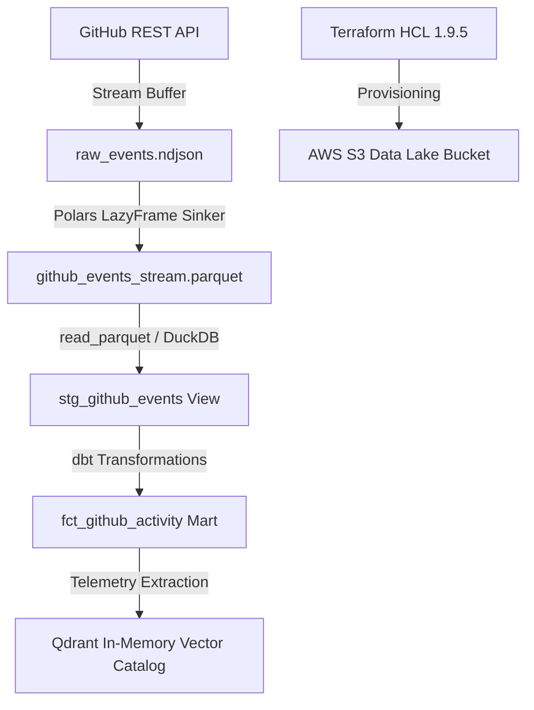

# Enterprise Data Platform Topology & Lineage

## End-to-End System Lineage Diagram

## Infrastructure & Compute Layers
- **Ingestion:** Native HTTP requests with exponential fallbacks to Polars streaming sinks.
- **Lakehouse Processing:** Embedded DuckDB in-memory OLAP engine reading ZSTD Parquet buffers.
- **Modeling & Testing:** dbt core transformations with schema validation assertions.
- **Orchestration:** Dagster Software-Defined Assets (SDAs) tracking materialization state.
- **AI Observability:** Qdrant vector collection indexing run payloads and schema embeddings.
